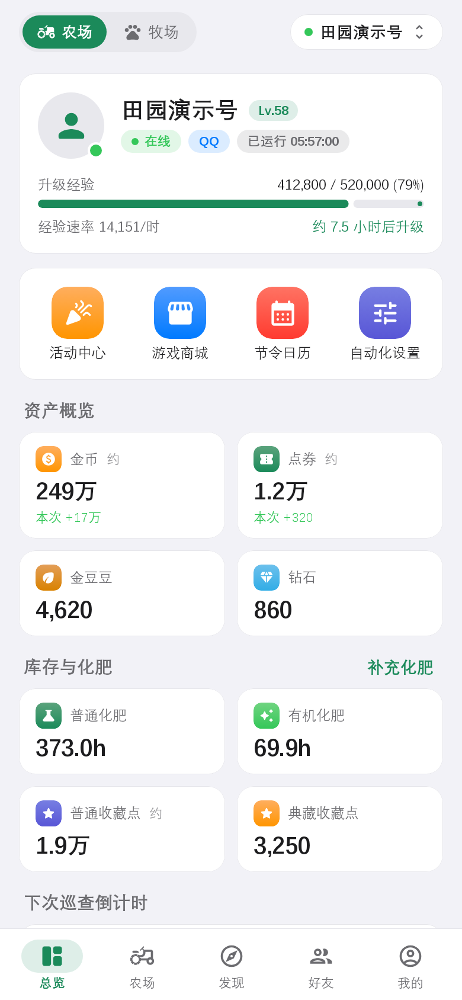
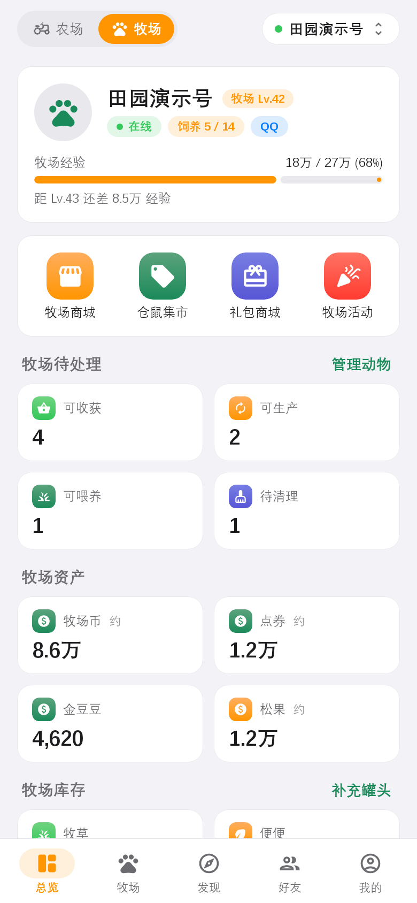
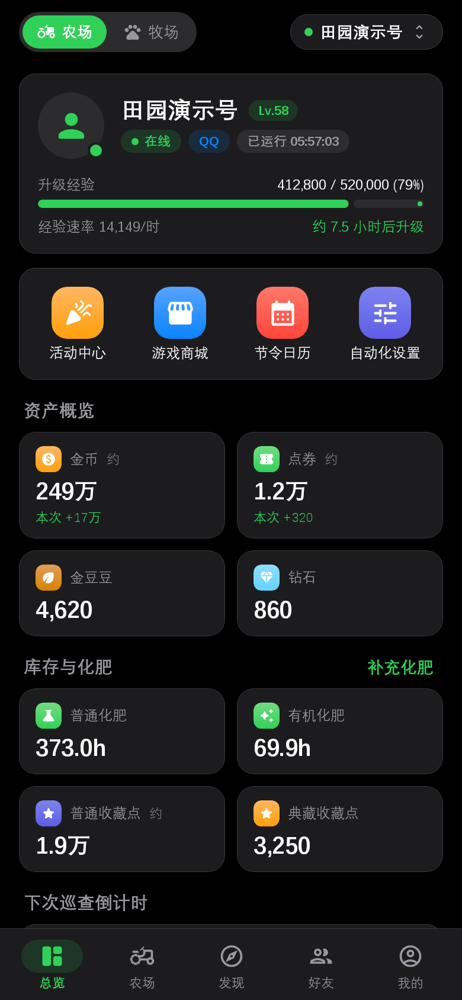

# Farm Mobile（农场助手）

面向开源自托管农场服务 ~~[liyangpengs/qq-farm-bot](https://github.com/liyangpengs/qq-farm-bot)~~(上游暂时换成[ccpopy/qq-farm-bot-upstream](https://github.com/ccpopy/qq-farm-bot-upstream))的原生 Android 客户端，基于 **Kotlin + Jetpack Compose + Material 3** 构建，直接对接后端 HTTP REST 与 Socket.IO 实时接口，不依赖 Web 套壳。

- 运行环境：**Android 8.0+（API 26+）**
- 应用包名：`io.github.ccpopy.farmmobile`
- 许可协议：[CC BY-NC-SA 4.0](LICENSE)（署名 · 非商业性使用 · 相同方式共享）

## 界面预览

<table>
  <tr>
    <td align="center"><b>农场总览</b></td>
    <td align="center"><b>牧场总览</b></td>
    <td align="center"><b>深色模式</b></td>
  </tr>
  <tr>
    <td align="center"></td>
    <td align="center"></td>
    <td align="center"></td>
  </tr>
</table>

> 注：以上截图使用模拟数据渲染，仅用于界面展示。

## 服务端兼容说明

- ~~直接配合 **[liyangpengs/qq-farm-bot](https://github.com/liyangpengs/qq-farm-bot)** 使用~~，上游暂时换成[ccpopy/qq-farm-bot-upstream](https://github.com/ccpopy/qq-farm-bot-upstream)，**建议后续需要的自己做好适配**。**无需修改服务端源码**，也不需要安装额外扩展插件。
- 支持使用服务端管理员**账号密码登录**，或直接填写已登录 Web 管理面板的 **`x-admin-token` 会话凭证**。
- 支持局域网 IP、域名与 HTTPS 反向代理，连接页默认留空并提供 `https://` 输入提示与 `/api/game-version` 连通性测试。

## 核心功能

- **双空间切换与多服务器管理**
  - 采用底部 5 标签导航：**总览 · 农场/牧场 · 发现 · 好友 · 我的**，并通过顶部全局 **「农场 ↔ 牧场」** 切换器同步总览、工作台、发现中心与好友视图。
  - 支持在「我的 → 服务器与授权」保存、切换、重命名与删除多个远程服务器，并在切换后自动恢复该服务器上次选中的账号。
- **实时总览与数据统计**
  - 通过 Socket.IO 实时同步账号在线状态、等级与经验进度、经验速率与升级预测、下次农场/好友巡查倒计时，以及今日收益统计与分空间运行日志。
  - 金币、点券、金豆豆、钻石、收藏点与牧场资产默认按 万 / 亿 / 万亿 紧凑展示，点击数据格即可切换查看完整精确数值。
  - 农场总览支持一键补充普通/有机化肥；牧场总览展示牧场待处理、**牧场生涯（累计产物、累计成熟、收取好友产物、收偷比）**、今日收益统计、设施容量进度与罐头补充入口。
- **农场与牧场工作台**
  - **农场工作台**：3 列土地宫格、土壤等级与升级状态、实时成熟倒计时、一键与单块地务农/种植/施肥操作、看门狗宠物喂养，以及支持**批量上锁 / 解锁**和礼包/化肥手动使用的农场背包。
  - **牧场工作台**：包含 **动物 / 设施 / 背包 / 任务** 4 个子视图，支持按窝/棚管理动物（含巨型体重与生产轮次）、补充牧草与罐头、设施升级与**沙漏加速**、背包物品**批量上锁 / 解锁**与一键出售，关键消费与放生动作均经服务端 `quote -> signature` 二次确认。
- **扩展与自动化**
  - **自动化设置**：从「总览」快捷入口或「我的 → 扩展与自动化 → 自动化设置」进入，配置种植策略（支持实时读取背包调整**背包种子优先顺序**）、养殖策略（含指定窝/棚动物及**背包幼崽优先顺序**）、巡查间隔、日常农牧、施肥策略、好友互动、静默时段与神秘商人购买策略，并可查看只读定时任务概览（`/api/scheduler`）。
  - **图鉴与藏品中心**：统一收纳于「我的 → 扩展与自动化 → 图鉴」，涵盖**作物图鉴**（含可购种子快捷下单）、**超变图鉴**、**蓝晶藏品**、**变异宝典**与**牧场图鉴**奖励领取，并对大图鉴网格进行了内存缓存与按显示尺寸降采样优化。
- **发现中心（活动 · 商城 · 节令日历）**
  - **活动中心**：同步限时、常驻与往期活动目录，内置牧歌初启、奶茶热销中、快乐不独享、秋祈良愿、千星游记、七夕鹊桥、青酿换万金、公益小红花与雨落成诗原生交互界面。
  - **商城系统**：农场模式覆盖游戏商城、限时商店、道具商店、SVIP 与神秘商人；牧场模式覆盖牧场商店（支持买后自动放置）、仓鼠集市与**礼包商城（礼包商城 / 特惠商城，含沙漏礼包）**。
  - **节令日历**：以日历卡片展示农历与公历节令，支持当季进度收集与趣味答题领奖。
- **农 / 牧场好友互动**
  - 农场好友支持可偷/可帮筛选、偷菜/帮务农/捣乱、查看好友土地网格、访客记录与黑名单管理。
  - 牧场好友列表展示可清理数量标记，详情抽屉整合好友牧场生涯（含收偷比）、一键清理异常、偷取货架、放蚊子与抚摸动物。
- **主题外观、防堆积通知与应用更新**
  - 支持浅色 / 深色 / 跟随系统主题，以及 Android 12+ Material You 动态取色开关（默认关闭）。
  - 农牧动态推送与账号掉线重登提醒默认均关闭；开启后支持 13 类农牧/好友动作自主订阅与分类折叠静默刷新（适配 Android 13+ `POST_NOTIFICATIONS` 权限引导）。
  - 支持在「我的 → 应用更新」检查 GitHub Releases 发布版本与更新说明，支持直连、镜像加速（默认 `https://ghfast.top`，可自定义）、自定义代理与可选 GitHub Token 授权，并对下载的 APK 进行完整性与签名校验。

## 安装与使用

1. 前往本仓库 [Releases](https://github.com/ccpopy/farm-mobile/releases) 下载最新签名安装包 `farm-mobile-<版本>-release.apk` 并安装。
2. 首次打开填写自托管服务端地址（如 `https://farm.example.com`），使用管理员账号密码或 `x-admin-token` 完成连接。
3. 在「总览」右上角选择需要管理的账号后，即可实时查看状态或切换至农场 / 牧场执行日常操作。

## 本地构建与发布

1. **本地开发**：使用 Android Studio 打开仓库根目录，需要 **JDK 17**、**Gradle 8.11.1** 与 **Android SDK Platform 35**：
   ```bash
   gradle assembleDebug
   ```
2. **GitHub Actions 自动构建与发布**（[android-build.yml](.github/workflows/android-build.yml)）：
   - 在仓库 **Settings → Secrets and variables → Actions** 配置：
     - `ANDROID_RELEASE_KEYSTORE_BASE64`：PKCS12 签名证书（`key alias` 须为 `farm-mobile`）的 Base64 编码
     - `ANDROID_RELEASE_KEYSTORE_PASSWORD`：签名证书密码
   - 同步更新 `app/build.gradle.kts` 中的 `versionCode` 与 `versionName` 后，推送与版本号一致的 `v<版本>` 附注标签触发发布：
     ```bash
     git tag -a v<版本> -F release-notes.md --cleanup=verbatim
     git push origin v<版本>
     ```
   - 工作流会自动执行 `gradle lintRelease assembleRelease --no-daemon`、APK 签名校验并创建 GitHub Release。

## 开源协议与使用条款

本项目采用 **[Creative Commons Attribution-NonCommercial-ShareAlike 4.0 International（CC BY-NC-SA 4.0 / 署名-非商业性使用-相同方式共享 4.0 国际许可协议）](LICENSE)** 授权发布：

- **禁止商业用途与倒卖**：严禁未经授权将本项目源码、编译产物（APK）或任何修改衍生版本用于商业用途或盈利行为，包括但不限于在闲鱼等二手交易平台或电商渠道倒卖源码/安装包、提供收费代装与收费代挂服务、或捆绑收费分发。
- **署名与相同方式共享（Fork / 衍生约束）**：任何 Fork、二次修改、再分发或基于本项目开发的衍生仓库，均必须保留原作者署名与项目出处说明，且必须继续以 **CC BY-NC-SA 4.0** 协议完整公开源码，不得去除、削弱或规避上述非商业与同协议开源限制。
- **商业授权与开源约定**：如确有商业合作或商业使用需求，须事先联系项目作者取得书面授权；经授权的商业衍生版本仍须按照授权约定保持源码开放。
